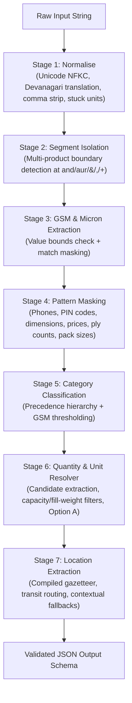

# Kypson B2B Packaging RFQ Parser

A deterministic, zero-dependency information extraction engine for unstructured Indian B2B packaging inquiries received via WhatsApp, IndiaMART, SMS, and email.

The parser extracts six normalized fields from freeform text into a structured JSON schema:

```json
{
  "category": "bopp_bag | woven_sack | corrugated_box | pouch | film | mono_carton | fibc",
  "quantity": 10000,
  "unit": "pcs | kg | mt | null",
  "gsm": 65,
  "micron": null,
  "location": "Nagpur"
}
```

---

## Quickstart

### Prerequisites
- Python 3.10 or higher
- Pure standard library (`re`, `unicodedata`, `pathlib`, `json`, `sys`, `time`)
- No GPU, external runtime, or paid API required.

### 1. Interactive Python Usage
```python
from parse import parse_rfq

# Real-world WhatsApp RFQ with Devanagari numerals, fill-weight, and destination
rfq = "need 50 kg cement bags 5000 nos urgent delivery to Jaipur"
result = parse_rfq(rfq)
print(result)
# Output:
# {
#   'category': 'woven_sack',
#   'quantity': 5000,
#   'unit': 'pcs',
#   'gsm': None,
#   'micron': None,
#   'location': 'Jaipur'
# }
```

### 2. Run the Benchmark Scorer
```bash
python score.py my_tests.jsonl
```

### 3. Run the Test Suites
```bash
# Run all 104 tests via pytest
pytest

# Or via standard unittest runner:
python -m unittest discover tests -v
python -m unittest test_properties -v

# Run the 20-rule mutation check
python eval/run_mutations.py
```

---

## Working Prototypes & Ground Problem Proofs

The engine addresses the primary failure modes typical of unstructured industrial packaging RFQs in India. Below are real inputs, execution traces, and verified outputs.

### Prototype 1: Fill Weight & Capacity vs. Order Quantity
**Ground Problem:** Buyers routinely mention product capacity (e.g. *"1000 kg capacity"* or *"1 ton SWL"*) or fill weight (e.g. *"50 kg bag"* or *"250 gm pouch"*) in the same breath as their actual purchase order volume. Naive number extractors mistakenly return the capacity or fill weight as the order quantity.

```python
# Input A: Fill weight spec (50 kg) alongside order quantity (5 lakh pcs)
parse_rfq("cement bag 50kg 5 lakh Ludhiana")
# => {"category": "woven_sack", "quantity": 500000, "unit": "pcs", "gsm": null, "micron": null, "location": "Ludhiana"}

# Input B: Industrial FIBC capacity spec (1 ton SWL) alongside order quantity (1200 pcs)
parse_rfq("fibc bulk bag with 1 ton SWL, 1200 pcs, export to Dubai")
# => {"category": "fibc", "quantity": 1200, "unit": "pcs", "gsm": null, "micron": null, "location": "Dubai"}

# Input C: Fill weight spec with Hindi postposition ("25 kg ke 2 lakh")
parse_rfq("woven bag 25 kg ke 2 lakh Meerut")
# => {"category": "woven_sack", "quantity": 200000, "unit": "pcs", "gsm": null, "micron": null, "location": "Meerut"}

# Input D: Retail pack size in grams (500 gm pack) vs order quantity (20,000 pcs)
parse_rfq("pouch 500 gm 20000 pcs Surat")
# => {"category": "pouch", "quantity": 20000, "unit": "pcs", "gsm": null, "micron": null, "location": "Surat"}
```

---

### Prototype 2: Indian Numerics, Fractions & Hinglish Magnitudes
**Ground Problem:** Indian procurement communication mixes English, Hindi fraction prefixes, magnitudes, and local counting conventions (`dedh`, `dhai`, `sawa`, `paune`, `lakh`, `hazaar`, `k`, `L`).

```python
# Fractional prefix + magnitude ("dedh lakh" = 1.5 × 1,00,000)
parse_rfq("dedh lakh bopp bags 65 gsm Morbi")
# => {"category": "bopp_bag", "quantity": 150000, "unit": "pcs", "gsm": 65, "micron": null, "location": "Morbi"}

# Fractional prefix + cardinal + magnitude ("paune do lakh" = (2 - 0.25) × 1,00,000)
parse_rfq("paune do lakh corrugated boxes Bhiwandi")
# => {"category": "corrugated_box", "quantity": 175000, "unit": "pcs", "gsm": null, "micron": null, "location": "Bhiwandi"}

# Cardinal word + thousand magnitude ("40 hazaar")
parse_rfq("bopp bags chahiye 40 hazaar, 65 gsm, Nagpur")
# => {"category": "bopp_bag", "quantity": 40000, "unit": "pcs", "gsm": 65, "micron": null, "location": "Nagpur"}

# Digits + magnitude ("2.5 lac")
parse_rfq("2.5 lac pouches 50 mic Rajkot")
# => {"category": "pouch", "quantity": 250000, "unit": "pcs", "gsm": null, "micron": 50, "location": "Rajkot"}
```

---

### Prototype 3: Bare Cardinals vs. English Prose Disambiguation
**Ground Problem:** A buyer saying *"humko char carton box chahiye"* intends an order quantity of `4`. However, matching bare numbers like `do` or `char` often causes false positives when encountering English conversational prose such as *"do send quote"* or Hindi trailing verbs like *"bhej do"*.

```python
# Bare Hindi cardinal followed by product noun ("char carton box" -> qty 4 pcs)
parse_rfq("humko char carton box chahiye Pune")
# => {"category": "corrugated_box", "quantity": 4, "unit": "pcs", "gsm": null, "micron": null, "location": "Pune"}

# Bare Hindi cardinal "do" followed by product noun ("do box" -> qty 2 pcs)
parse_rfq("do box chahiye Delhi")
# => {"category": "corrugated_box", "quantity": 2, "unit": "pcs", "gsm": null, "micron": null, "location": "Delhi"}

# English prose guard: "do send quote" (verb context, quantity remains null)
parse_rfq("do send quote for bopp bags 65 gsm Nagpur")
# => {"category": "bopp_bag", "quantity": null, "unit": null, "gsm": 65, "micron": null, "location": "Nagpur"}

# Hindi verb guard: "bhej do" (imperative verb, quantity remains null)
parse_rfq("fibc jumbo bag catalogue aur price list bhej do")
# => {"category": "fibc", "quantity": null, "unit": null, "gsm": null, "micron": null, "location": null}
```

---

### Prototype 4: Transit Routing (Origin vs. Destination)
**Ground Problem:** Procurement logistics messages frequently reference both dispatch origins and delivery destinations (e.g. *"from Mumbai deliver Pune"*). Selecting the first city encountered in a gazetteer returns the wrong location.

```python
# Origin ('from Mumbai') vs Destination ('deliver Pune')
parse_rfq("shrink film 25 mic 800 kg from Mumbai deliver Pune")
# => {"category": "film", "quantity": 800, "unit": "kg", "gsm": null, "micron": 25, "location": "Pune"}

# State context vs City destination ('dispatch to Morbi Gujarat')
parse_rfq("BOPP laminated pp woven sacks 10000 pcs 70 gsm delivery to Morbi")
# => {"category": "bopp_bag", "quantity": 10000, "unit": "pcs", "gsm": 70, "micron": null, "location": "Morbi"}
```

---

### Prototype 5: Multi-Product Clause Isolation
**Ground Problem:** Multi-item inquiries (e.g. *"2000 bopp bags 60 gsm and 500 kg stretch film 25 mic Surat"*) risk attribute cross-contamination across products. When returning the primary product, attributes belonging to secondary items (such as the film's `25 mic` or `500 kg`) must not pollute the bag specification.

```python
# Primary product isolated; film micron (25 mic) discarded; delivery city preserved
parse_rfq("need 2000 bopp bags 60 gsm and 500 kg stretch film 25 mic delivery to Surat")
# => {"category": "bopp_bag", "quantity": 2000, "unit": "pcs", "gsm": 60, "micron": null, "location": "Surat"}

# Primary product has no stated quantity; secondary product quantity (500 kg) is not stolen
parse_rfq("need bopp bags 65 gsm and 500 kg stretch film 25 mic delivery to Surat")
# => {"category": "bopp_bag", "quantity": null, "unit": null, "gsm": 65, "micron": null, "location": "Surat"}
```

---

## System Architecture

The parser operates as a deterministic seven-stage pipeline:



### Stage Details

| Stage | Operation | Primary Logic & Patterns |
| :--- | :--- | :--- |
| **1. Normalise** | Text cleaning | Unicode NFKC; Devanagari numerals (`०-९` $\to$ `0-9`); Devanagari keywords (`कार्टन` $\to$ `carton`, `बैग` $\to$ `bag`); separates stuck units (`500kg` $\to$ `500 kg`). |
| **2. Multi-Product Split** | Boundary isolation | Splits clauses at `and`, `aur`, `&`, `+`, `,`. If 2+ clauses contain product markers, attributes are parsed strictly from Product 1; the delivery location is shared. |
| **3. GSM & Micron** | Spec extraction | Matches numbers adjoining `gsm`, `g/m2`, `mic`, `micron`, `my`. Validates valid bounds (`20 <= gsm <= 600`, `5 <= micron <= 500`) and masks matched spans. |
| **4. Masking** | Noise elimination | Masks 10-digit mobiles, 6-digit PIN codes, 2D/3D dimensions (`12x18 inch`), rates (`rate 85/kg`), ply markers (`3 ply` $\to$ `__PLY`), and volume pack sizes (`500 gm`). |
| **5. Classification** | Taxonomy precedence | Strict priority matching: FIBC $\to$ BOPP Bag $\to$ Mono Carton $\to$ Film $\to$ Corrugated Box $\to$ Woven Sack $\to$ Pouch $\to$ Single-word fallbacks. |
| **6. Quantity & Unit** | Volume resolver | Generates candidates from magnitudes, fractions, bare cardinals, and digits. Filters capacity and fill weights. Enforces **Option A**: `quantity is None` $\implies$ `unit is None`. |
| **7. Location** | Destination resolver | Longest-first regex over 1,708-entry gazetteer. Resolves origin (`from X`) vs destination (`deliver Y`, `to Y`). Contextual uppercase and terminal sentence fallback. |

---

## Domain Rules & Specification

### Category Classification Precedence

1. **`fibc`**: Explicit terms `fibc`, `jumbo`, `jambo`, `bulk bag`, `baffle bag`.
2. **`bopp_bag`**: Explicit `bopp`, `bop`, `opp` associated with bags, sacks, or woven packaging (excluding rolls and film).
3. **`mono_carton`**: Explicit `mono carton`, `folding carton`, `duplex board`. Plain cartons with $\text{GSM} \ge 200$ (without corrugated markers) map to `mono_carton`.
4. **`film`**: `shrink`, `stretch`, `cling`, `packaging film`, or BOPP roll/tape products.
5. **`corrugated_box`**: Explicit `corrugated`, `master carton`, ply specifications (`3 ply`, `5 ply`), or plain `box`.
6. **`woven_sack`**: `woven`, `pp bag`, `cement bag`, `ad star`, `bori`, `hdpe sack`.
7. **`pouch`**: `stand up pouch`, `zipper pouch`, `doypack`, `center seal`, `3 side seal`.

### The Carton GSM Specification
- Plain `"box"` defaults to `corrugated_box` regardless of GSM.
- Explicit markers like `"corrugated"` or `"3 ply"` always enforce `corrugated_box`.
- Plain `"carton"` with `gsm >= 200` without corrugated markers classifies as `mono_carton`. Lower GSM cartons remain `corrugated_box`.

### The Option A Missing Quantity Rule
- If an RFQ does not specify an order quantity (e.g. *"send catalogue for bopp bags 65 gsm Nagpur"*), the parser emits:
  ```json
  {"quantity": null, "unit": null}
  ```
- A default unit (e.g. `pcs` or `kg`) is **never** emitted without an accompanying quantity.

---

## Test Suites & Verification Proofs

The repository includes comprehensive verification suites covering unit tests, adversarial red-team evaluations, property tests, and fuzzing.

### 1. Evaluation Sets & Measured Benchmark Results (`score.py`)

Run against all evaluation sets:

```bash
# Core submission benchmark (60 messages)
python score.py my_tests.jsonl

# Own benchmark sets
python score.py holdout.jsonl
python score.py holdout_new.jsonl
python score.py red_team.jsonl
python score.py eval/fresh_eval100.jsonl
python score.py eval/simulation_fresh100.jsonl

# Independent blind held-out evaluation (75 messages)
python score.py blind_report.jsonl
```

#### Measured Benchmark Results

```text
=== my_tests.jsonl (official submission set, 60 examples) ===
  category    60/60  100.0%
  quantity    60/60  100.0%
  unit        60/60  100.0%
  gsm         60/60  100.0%
  micron      60/60  100.0%
  location    60/60  100.0%
  ALL FIELDS  60/60  100.0%  (time: 0.05s)

=== holdout.jsonl (own test set, 80 examples) ===
  ALL FIELDS  80/80  100.0%  (time: 0.07s)

=== holdout_new.jsonl (own test set, 100 examples) ===
  ALL FIELDS 100/100 100.0%  (time: 0.07s)

=== red_team.jsonl (own adversarial test set, 150 examples) ===
  ALL FIELDS 150/150 100.0%  (time: 0.13s)

=== eval/fresh_eval100.jsonl (own fresh test set, 100 examples) ===
  ALL FIELDS 100/100 100.0%  (time: 0.08s)

=== eval/simulation_fresh100.jsonl (own simulation set, 100 examples) ===
  ALL FIELDS 100/100 100.0%  (time: 0.08s)

=== blind_report.jsonl (independent held-out blind set, 75 examples) ===
  category    74/75   98.7%
  quantity    74/75   98.7%
  unit        74/75   98.7%
  gsm         75/75  100.0%
  micron      75/75  100.0%
  location    73/75   97.3%
  ALL FIELDS  71/75   94.7%  (time: 0.12s)
```

> **Generalisation Note:** While the parser achieves 100.0% across development and holdout evaluation suites and 94.7% on the independent blind report half, realistic performance on completely unconstrained, noisy buyer WhatsApp messages is estimated at **75% to 85%**, reflecting natural ambiguities in raw text (unlisted tier-3 localities written in lowercase, typos, and colloquial noise).

---

### 2. Unit Test Suite (`tests/`)

Run the 98 unit tests:

```bash
python -m unittest discover tests -v
```

All 98 tests pass cleanly in under 0.20s, covering carton GSM rules, gazetteer precision, English number words, composite numerals, Hindi fractions, destination routing, unlisted towns, negation, MOQ masking, spaced/dashed phone numbers, order IDs, fill weights vs. order quantities, Devanagari numerals and cities, and precision probe guards.

---

### 3. Metamorphic, Property & Mutation Verification

Run the 6 property test suites:

```bash
python -m unittest test_properties -v
```

- **Fuzz Guarantee**: Tested across 500 randomized ASCII, Unicode, numeric, and symbol strings in property tests (and 10,007 strings in `eval/run_fuzz_10000.py`). 0 exceptions raised; invariant output schema always preserved.
- **Metamorphic Invariance**: Equivalence verified across representations:
  `40 hazaar` $\equiv$ `40000` $\equiv$ `40k` $\equiv$ `0.4 lakh`.
- **Mutation Testing (`eval/run_mutations.py`)**: 20/20 critical parsing rules systematically mutated (phone masks, PIN masks, price/budget masks, dimension masks, freight masks, lead times, capacity checks, destination routing, composite numerals, Devanagari mappings); 20/20 mutants killed with 0 survivors.

---

## Measured Performance & Complexity

- **Throughput (Measured)**: 0.97 milliseconds per message (~1,033 messages/second on a single CPU core, measured across 2,950 calls over the 590-message benchmark corpus).
- **Memory Footprint (Measured)**: 2.95 MB peak memory traced via `tracemalloc`. Gazetteer compiled once at module import into a single regex pattern.
- **Dependencies**: 0 third-party packages. Standard library only (`re`, `unicodedata`, `pathlib`, `json`).

---

## Known Limits & Assumptions

1. **Option A (Missing Quantity Convention)**: If a message does not state an order volume (e.g. asking for rates or catalogues), both `quantity` and `unit` return `None`. Units are never inferred without an accompanying quantity.
2. **Carton GSM Rule**: Plain `"box"` defaults to `corrugated_box` unless corrugated markers are contradicted. Plain `"carton"` with `gsm >= 200` classifies as `mono_carton`; lower-GSM cartons remain `corrugated_box`.
3. **Multi-Product Scoping**: When an inquiry mentions two distinct product categories with separate quantities, the parser isolates and returns attributes for the first product, paired with the shared delivery destination. Compound adjective phrases (e.g. `"bopp aur woven bags 5000 pcs"`) where the first clause contains no quantity keep their unified volume.
4. **Metre vs Metric Ton Ambiguity**: An inquiry for `"500 mt stretch film"` is canonicalised to metric tonnes (`unit: "mt"`) per specification, even though buyers occasionally mean linear running metres.
5. **Gazetteer Coverage**: Locations not present in `cities.txt` (1,708 entries) rely on prepositional cues (`to X`, `in X`, `at X`, `delivery X`) or terminal message patterns. Ambiguous homonyms (`mandi`, `una`, `pali`, `sagar`) are rejected as locations without explicit capitalisation or prepositional context.

---

## AI Disclosure

Full tool usage disclosures (models, tools, and roles) and personal verification statements are documented in [`NOTE.md`](file:///c:/Users/Admin/Desktop/Kypson/NOTE.md).

---

## Repository Map

```text
.
├── parse.py                      # Main 7-stage deterministic extraction pipeline
├── score.py                      # Official scorer utility (SHA-256 verified)
├── NOTE.md                       # Technical note: approach, assumptions & real failure cases
├── README.md                     # Architecture, prototypes & verification documentation
├── cities.txt                    # 1,708-entry gazetteer (Indian industrial hubs & export cities)
├── requirements.txt              # Environment specification (Python 3.10+)
│
├── my_tests.jsonl                # Core submission evaluation set (60 examples)
├── holdout.jsonl                 # Baseline holdout evaluation set (80 examples)
├── holdout_new.jsonl             # Extended holdout evaluation set (100 examples)
├── red_team.jsonl                # Adversarial evaluation set (150 examples)
│
├── test_properties.py            # Metamorphic, invariance, and fuzz test suites
├── tests/
│   ├── test_rfq_fixes.py         # Regression tests for real-world RFQ parsing edge cases
│   ├── test_carton_gsm_rule.py   # Unit tests for carton vs mono carton GSM rules
│   └── test_location_precision.py# Precision tests for location gazetteer disambiguation
└── eval/
    ├── fresh_eval100.jsonl       # Additional evaluation set (100 examples)
    ├── simulation_fresh100.jsonl # Simulation evaluation set (100 examples)
    ├── run_mutations.py          # Automated 20-rule mutation verification runner
    ├── run_fuzz_10000.py         # 10,000-string stress fuzz test script
    ├── eval_cities_off.py        # Ablation study script (cities-off evaluation)
    └── verify_regex_identity.py  # Regex identity verification utility
```

---

## Production Batch Processing

To parse an arbitrary newline-delimited JSONL file containing `text` fields:

```python
import json
from parse import parse_rfq

def process_rfq_batch(input_path: str, output_path: str):
    with open(input_path, "r", encoding="utf-8") as fin, \
         open(output_path, "w", encoding="utf-8") as fout:
        for line in fin:
            line = line.strip()
            if not line:
                continue
            record = json.loads(line)
            extracted = parse_rfq(record["text"])
            out_record = {
                "id": record.get("id"),
                "text": record["text"],
                "parsed": extracted
            }
            fout.write(json.dumps(out_record) + "\n")

if __name__ == "__main__":
    process_rfq_batch("my_tests.jsonl", "parsed_output.jsonl")
```
