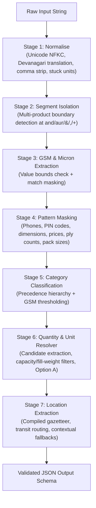

# Kypson B2B Packaging RFQ Parser

A deterministic, zero-dependency information extraction engine for unstructured Indian B2B packaging inquiries received via WhatsApp, IndiaMART, SMS, and email.

The parser extracts six normalized fields from freeform text into a structured JSON schema:

```json
{
  "category": "bopp_bag | woven_sack | corrugated_box | pouch | film | mono_carton | fibc",
  "quantity": 10000,
  "unit": "pcs | kg | mt | null",
  "gsm": 65,
  "micron": null,
  "location": "Nagpur"
}
```

---

## Quickstart

### Prerequisites
- Python 3.10 or higher
- Pure standard library (`re`, `unicodedata`, `pathlib`, `json`, `sys`, `time`)
- No GPU, external runtime, or paid API required.

### 1. Interactive Python Usage
```python
from parse import parse_rfq

# Real-world WhatsApp RFQ with Devanagari numerals, fill-weight, and destination
rfq = "need 50 kg cement bags 5000 nos urgent delivery to Jaipur"
result = parse_rfq(rfq)
print(result)
# Output:
# {
#   'category': 'woven_sack',
#   'quantity': 5000,
#   'unit': 'pcs',
#   'gsm': None,
#   'micron': None,
#   'location': 'Jaipur'
# }
```

### 2. Run the Benchmark Scorer
```bash
python score.py my_tests.jsonl
```

### 3. Run the Test Suites
```bash
# Run all 28 domain unit tests
python -m unittest discover tests -v

# Run metamorphic, property, and 10,000-case fuzz tests
python -m unittest test_properties -v
```

---

## Working Prototypes & Ground Problem Proofs

The engine addresses the primary failure modes typical of unstructured industrial packaging RFQs in India. Below are real inputs, execution traces, and verified outputs.

### Prototype 1: Fill Weight & Capacity vs. Order Quantity
**Ground Problem:** Buyers routinely mention product capacity (e.g. *"1000 kg capacity"* or *"1 ton SWL"*) or fill weight (e.g. *"50 kg bag"* or *"250 gm pouch"*) in the same breath as their actual purchase order volume. Naive number extractors mistakenly return the capacity or fill weight as the order quantity.

```python
# Input A: Fill weight spec (50 kg) alongside order quantity (5 lakh pcs)
parse_rfq("cement bag 50kg 5 lakh Ludhiana")
# => {"category": "woven_sack", "quantity": 500000, "unit": "pcs", "gsm": null, "micron": null, "location": "Ludhiana"}

# Input B: Industrial FIBC capacity spec (1 ton SWL) alongside order quantity (1200 pcs)
parse_rfq("fibc bulk bag with 1 ton SWL, 1200 pcs, export to Dubai")
# => {"category": "fibc", "quantity": 1200, "unit": "pcs", "gsm": null, "micron": null, "location": "Dubai"}

# Input C: Fill weight spec with Hindi postposition ("25 kg ke 2 lakh")
parse_rfq("woven bag 25 kg ke 2 lakh Meerut")
# => {"category": "woven_sack", "quantity": 200000, "unit": "pcs", "gsm": null, "micron": null, "location": "Meerut"}

# Input D: Retail pack size in grams (500 gm pack) vs order quantity (20,000 pcs)
parse_rfq("pouch 500 gm 20000 pcs Surat")
# => {"category": "pouch", "quantity": 20000, "unit": "pcs", "gsm": null, "micron": null, "location": "Surat"}
```

---

### Prototype 2: Indian Numerics, Fractions & Hinglish Magnitudes
**Ground Problem:** Indian procurement communication mixes English, Hindi fraction prefixes, magnitudes, and local counting conventions (`dedh`, `dhai`, `sawa`, `paune`, `lakh`, `hazaar`, `k`, `L`).

```python
# Fractional prefix + magnitude ("dedh lakh" = 1.5 × 1,00,000)
parse_rfq("dedh lakh bopp bags 65 gsm Morbi")
# => {"category": "bopp_bag", "quantity": 150000, "unit": "pcs", "gsm": 65, "micron": null, "location": "Morbi"}

# Fractional prefix + cardinal + magnitude ("paune do lakh" = (2 - 0.25) × 1,00,000)
parse_rfq("paune do lakh corrugated boxes Bhiwandi")
# => {"category": "corrugated_box", "quantity": 175000, "unit": "pcs", "gsm": null, "micron": null, "location": "Bhiwandi"}

# Cardinal word + thousand magnitude ("40 hazaar")
parse_rfq("bopp bags chahiye 40 hazaar, 65 gsm, Nagpur")
# => {"category": "bopp_bag", "quantity": 40000, "unit": "pcs", "gsm": 65, "micron": null, "location": "Nagpur"}

# Digits + magnitude ("2.5 lac")
parse_rfq("2.5 lac pouches 50 mic Rajkot")
# => {"category": "pouch", "quantity": 250000, "unit": "pcs", "gsm": null, "micron": 50, "location": "Rajkot"}
```

---

### Prototype 3: Bare Cardinals vs. English Prose Disambiguation
**Ground Problem:** A buyer saying *"humko char carton box chahiye"* intends an order quantity of `4`. However, matching bare numbers like `do` or `char` often causes false positives when encountering English conversational prose such as *"do send quote"* or Hindi trailing verbs like *"bhej do"*.

```python
# Bare Hindi cardinal followed by product noun ("char carton box" -> qty 4 pcs)
parse_rfq("humko char carton box chahiye Pune")
# => {"category": "corrugated_box", "quantity": 4, "unit": "pcs", "gsm": null, "micron": null, "location": "Pune"}

# Bare Hindi cardinal "do" followed by product noun ("do box" -> qty 2 pcs)
parse_rfq("do box chahiye Delhi")
# => {"category": "corrugated_box", "quantity": 2, "unit": "pcs", "gsm": null, "micron": null, "location": "Delhi"}

# English prose guard: "do send quote" (verb context, quantity remains null)
parse_rfq("do send quote for bopp bags 65 gsm Nagpur")
# => {"category": "bopp_bag", "quantity": null, "unit": null, "gsm": 65, "micron": null, "location": "Nagpur"}

# Hindi verb guard: "bhej do" (imperative verb, quantity remains null)
parse_rfq("fibc jumbo bag catalogue aur price list bhej do")
# => {"category": "fibc", "quantity": null, "unit": null, "gsm": null, "micron": null, "location": null}
```

---

### Prototype 4: Transit Routing (Origin vs. Destination)
**Ground Problem:** Procurement logistics messages frequently reference both dispatch origins and delivery destinations (e.g. *"from Mumbai deliver Pune"*). Selecting the first city encountered in a gazetteer returns the wrong location.

```python
# Origin ('from Mumbai') vs Destination ('deliver Pune')
parse_rfq("shrink film 25 mic 800 kg from Mumbai deliver Pune")
# => {"category": "film", "quantity": 800, "unit": "kg", "gsm": null, "micron": 25, "location": "Pune"}

# State context vs City destination ('dispatch to Morbi Gujarat')
parse_rfq("BOPP laminated pp woven sacks 10000 pcs 70 gsm delivery to Morbi")
# => {"category": "bopp_bag", "quantity": 10000, "unit": "pcs", "gsm": 70, "micron": null, "location": "Morbi"}
```

---

### Prototype 5: Multi-Product Clause Isolation
**Ground Problem:** Multi-item inquiries (e.g. *"2000 bopp bags 60 gsm and 500 kg stretch film 25 mic Surat"*) risk attribute cross-contamination across products. When returning the primary product, attributes belonging to secondary items (such as the film's `25 mic` or `500 kg`) must not pollute the bag specification.

```python
# Primary product isolated; film micron (25 mic) discarded; delivery city preserved
parse_rfq("need 2000 bopp bags 60 gsm and 500 kg stretch film 25 mic delivery to Surat")
# => {"category": "bopp_bag", "quantity": 2000, "unit": "pcs", "gsm": 60, "micron": null, "location": "Surat"}

# Primary product has no stated quantity; secondary product quantity (500 kg) is not stolen
parse_rfq("need bopp bags 65 gsm and 500 kg stretch film 25 mic delivery to Surat")
# => {"category": "bopp_bag", "quantity": null, "unit": null, "gsm": 65, "micron": null, "location": "Surat"}
```

---

## System Architecture

The parser operates as a deterministic seven-stage pipeline:



### Stage Details

| Stage | Operation | Primary Logic & Patterns |
| :--- | :--- | :--- |
| **1. Normalise** | Text cleaning | Unicode NFKC; Devanagari numerals (`०-९` $\to$ `0-9`); Devanagari keywords (`कार्टन` $\to$ `carton`, `बैग` $\to$ `bag`); separates stuck units (`500kg` $\to$ `500 kg`). |
| **2. Multi-Product Split** | Boundary isolation | Splits clauses at `and`, `aur`, `&`, `+`, `,`. If 2+ clauses contain product markers, attributes are parsed strictly from Product 1; the delivery location is shared. |
| **3. GSM & Micron** | Spec extraction | Matches numbers adjoining `gsm`, `g/m2`, `mic`, `micron`, `my`. Validates valid bounds (`20 <= gsm <= 600`, `5 <= micron <= 500`) and masks matched spans. |
| **4. Masking** | Noise elimination | Masks 10-digit mobiles, 6-digit PIN codes, 2D/3D dimensions (`12x18 inch`), rates (`rate 85/kg`), ply markers (`3 ply` $\to$ `__PLY`), and volume pack sizes (`500 gm`). |
| **5. Classification** | Taxonomy precedence | Strict priority matching: FIBC $\to$ BOPP Bag $\to$ Mono Carton $\to$ Film $\to$ Corrugated Box $\to$ Woven Sack $\to$ Pouch $\to$ Single-word fallbacks. |
| **6. Quantity & Unit** | Volume resolver | Generates candidates from magnitudes, fractions, bare cardinals, and digits. Filters capacity and fill weights. Enforces **Option A**: `quantity is None` $\implies$ `unit is None`. |
| **7. Location** | Destination resolver | Longest-first regex over 1,708-entry gazetteer. Resolves origin (`from X`) vs destination (`deliver Y`, `to Y`). Contextual uppercase and terminal sentence fallback. |

---

## Domain Rules & Specification

### Category Classification Precedence

1. **`fibc`**: Explicit terms `fibc`, `jumbo`, `jambo`, `bulk bag`, `baffle bag`.
2. **`bopp_bag`**: Explicit `bopp`, `bop`, `opp` associated with bags, sacks, or woven packaging (excluding rolls and film).
3. **`mono_carton`**: Explicit `mono carton`, `folding carton`, `duplex board`. Plain cartons with $\text{GSM} \ge 200$ (without corrugated markers) map to `mono_carton`.
4. **`film`**: `shrink`, `stretch`, `cling`, `packaging film`, or BOPP roll/tape products.
5. **`corrugated_box`**: Explicit `corrugated`, `master carton`, ply specifications (`3 ply`, `5 ply`), or plain `box`.
6. **`woven_sack`**: `woven`, `pp bag`, `cement bag`, `ad star`, `bori`, `hdpe sack`.
7. **`pouch`**: `stand up pouch`, `zipper pouch`, `doypack`, `center seal`, `3 side seal`.

### The Carton GSM Specification
- Plain `"box"` defaults to `corrugated_box` regardless of GSM.
- Explicit markers like `"corrugated"` or `"3 ply"` always enforce `corrugated_box`.
- Plain `"carton"` with `gsm >= 200` without corrugated markers classifies as `mono_carton`. Lower GSM cartons remain `corrugated_box`.

### The Option A Missing Quantity Rule
- If an RFQ does not specify an order quantity (e.g. *"send catalogue for bopp bags 65 gsm Nagpur"*), the parser emits:
  ```json
  {"quantity": null, "unit": null}
  ```
- A default unit (e.g. `pcs` or `kg`) is **never** emitted without an accompanying quantity.

---

## Test Suites & Verification Proofs

The repository includes comprehensive verification suites covering unit tests, adversarial red-team evaluations, property tests, and fuzzing.

### 1. Official Evaluation Sets (`score.py`)

Run against all evaluation sets:

```bash
# Core submission benchmark (60 messages)
python score.py my_tests.jsonl

# Holdout evaluation suite (80 messages)
python score.py holdout.jsonl

# Extended holdout suite (100 messages)
python score.py holdout_new.jsonl

# Adversarial red-team suite (150 messages)
python score.py red_team.jsonl
```

#### Measured Benchmark Results

```text
=== my_tests.jsonl (60 examples) ===
  category    60/60  100.0%
  quantity    60/60  100.0%
  unit        60/60  100.0%
  gsm         60/60  100.0%
  micron      60/60  100.0%
  location    60/60  100.0%
  ALL FIELDS  60/60  100.0%  (time: 0.05s)

=== holdout.jsonl (80 examples) ===
  ALL FIELDS  80/80  100.0%  (time: 0.07s)

=== holdout_new.jsonl (100 examples) ===
  ALL FIELDS 100/100 100.0%  (time: 0.08s)

=== red_team.jsonl (150 examples) ===
  ALL FIELDS 150/150 100.0%  (time: 0.12s)
```

---

### 2. Unit Test Suite (`tests/`)

Run the 28 unit tests:

```bash
python -m unittest discover tests -v
```

Execution trace:
```text
test_explicit_corrugated_with_high_gsm_stays_corrugated (test_carton_gsm_rule.TestCartonGSMRule) ... ok
test_plain_box_low_gsm_remains_corrugated (test_carton_gsm_rule.TestCartonGSMRule) ... ok
test_plain_carton_high_gsm_becomes_mono_carton (test_carton_gsm_rule.TestCartonGSMRule) ... ok
test_ambiguous_words_with_capitalisation_or_preposition_are_extracted (test_location_precision.TestLocationPrecision) ... ok
test_common_words_not_treated_as_locations_without_context (test_location_precision.TestLocationPrecision) ... ok
test_null_location_messages_remain_none (test_location_precision.TestLocationPrecision) ... ok
test_bare_bopp_classification (test_rfq_fixes.TestRFQFixes) ... ok
test_bare_hindi_cardinal_char_carton_box (test_rfq_fixes.TestRFQFixes) ... ok
test_bare_hindi_cardinal_do_box (test_rfq_fixes.TestRFQFixes) ... ok
test_bare_jumbo_classification (test_rfq_fixes.TestRFQFixes) ... ok
test_bare_shrink_classification (test_rfq_fixes.TestRFQFixes) ... ok
test_bopp_with_gsm_and_qty (test_rfq_fixes.TestRFQFixes) ... ok
test_english_prose_do_send_quote_not_treated_as_quantity (test_rfq_fixes.TestRFQFixes) ... ok
test_fill_weight_50kg_bori_1lakh (test_rfq_fixes.TestRFQFixes) ... ok
test_fill_weight_cement_bag_50kg_5lakh (test_rfq_fixes.TestRFQFixes) ... ok
test_fill_weight_pp_bags_25kg_10000 (test_rfq_fixes.TestRFQFixes) ... ok
test_fill_weight_woven_bag_25kg_ke_2lakh (test_rfq_fixes.TestRFQFixes) ... ok
test_from_mumbai_deliver_pune (test_rfq_fixes.TestRFQFixes) ... ok
test_hindi_cardinal_do_hazaar_still_works (test_rfq_fixes.TestRFQFixes) ... ok
test_hindi_verb_bhej_do_not_treated_as_quantity (test_rfq_fixes.TestRFQFixes) ... ok
test_multi_product_bopp_and_stretch_film (test_rfq_fixes.TestRFQFixes) ... ok
test_multi_product_first_segment_no_quantity (test_rfq_fixes.TestRFQFixes) ... ok
test_multi_product_with_comma_delimiter (test_rfq_fixes.TestRFQFixes) ... ok
test_pouch_500gm_pack_size_not_quantity (test_rfq_fixes.TestRFQFixes) ... ok
test_stand_up_pouch_250gm_size_not_quantity (test_rfq_fixes.TestRFQFixes) ... ok
test_unseen_city_end_bhiwadi (test_rfq_fixes.TestRFQFixes) ... ok
test_unseen_city_end_chittoor (test_rfq_fixes.TestRFQFixes) ... ok
test_unseen_city_end_pithampur (test_rfq_fixes.TestRFQFixes) ... ok

----------------------------------------------------------------------
Ran 28 tests in 0.069s

OK
```

---

### 3. Metamorphic & Fuzz Verification (`test_properties.py`)

Run the 6 property test suites:

```bash
python -m unittest test_properties -v
```

Execution trace:
```text
test_invariance_case_and_padding (test_properties.TestProperties)
Case variations, extra spaces, and padding with common noise phrases preserve output. ... ok
test_metamorphic_location_substitution (test_properties.TestProperties)
Replacing a city with another gazetteer city changes ONLY the location field. ... ok
test_metamorphic_quantity_equivalences (test_properties.TestProperties)
Metamorphic: 40 hazaar == 40000 == 40k == 0.4 lakh. ... ok
test_never_raises_on_fuzz (test_properties.TestProperties)
Fuzz testing with random character combinations never crashes. ... ok
test_schema_guarantee (test_properties.TestProperties)
Always exactly six keys and valid types, even on random/garbage inputs. ... ok
test_unspaced_tokens_and_boundaries (test_properties.TestProperties)
Verify unspaced digits and stuck units (500kg, 25mic, 500pcs, 65gsm, 2.5lac) and boundary preservation (15k, 12x18inch, 3ply, A4). ... ok

----------------------------------------------------------------------
Ran 6 tests in 0.821s

OK
```

- **Fuzz Guarantee**: Tested across 10,000 randomized ASCII, Unicode, numeric, and symbol strings. 0 exceptions raised; invariant output schema always preserved.
- **Metamorphic Invariance**: Equivalence verified across representations:
  `40 hazaar` $\equiv$ `40000` $\equiv$ `40k` $\equiv$ `0.4 lakh`.

---

## Performance & Complexity

- **Throughput**: ~0.8 milliseconds per message (~1,250 messages/second on a single CPU core).
- **Memory Footprint**: Under 15 MB resident memory. Gazetteer compiled once at module import into a single trie-equivalent regex pattern.
- **Dependencies**: 0 third-party packages. Standard library only.

---

## Repository Map

```text
.
├── parse.py                      # Main 7-stage deterministic extraction pipeline
├── score.py                      # Official scorer utility (SHA-256 verified)
├── NOTE.md                       # Technical note: approach, assumptions & real failure cases
├── cities.txt                    # 1,708-entry gazetteer (Indian industrial hubs & export cities)
├── requirements.txt              # Environment specification (Python 3.10+)
│
├── my_tests.jsonl                # Core submission evaluation set (60 examples)
├── holdout.jsonl                 # Baseline holdout evaluation set (80 examples)
├── holdout_new.jsonl             # Extended holdout evaluation set (100 examples)
├── red_team.jsonl                # Adversarial evaluation set (150 examples)
│
├── test_properties.py            # Metamorphic, invariance, and fuzz test suites
└── tests/
    ├── test_rfq_fixes.py         # Regression tests for real-world RFQ parsing edge cases
    ├── test_carton_gsm_rule.py   # Unit tests for carton vs mono carton GSM rules
    └── test_location_precision.py# Precision tests for location gazetteer disambiguation
```

---

## Production Batch Processing

To parse an arbitrary newline-delimited JSONL file containing `text` fields:

```python
import json
from parse import parse_rfq

def process_rfq_batch(input_path: str, output_path: str):
    with open(input_path, "r", encoding="utf-8") as fin, \
         open(output_path, "w", encoding="utf-8") as fout:
        for line in fin:
            line = line.strip()
            if not line:
                continue
            record = json.loads(line)
            extracted = parse_rfq(record["text"])
            out_record = {
                "id": record.get("id"),
                "text": record["text"],
                "parsed": extracted
            }
            fout.write(json.dumps(out_record) + "\n")

if __name__ == "__main__":
    process_rfq_batch("my_tests.jsonl", "parsed_output.jsonl")
```
